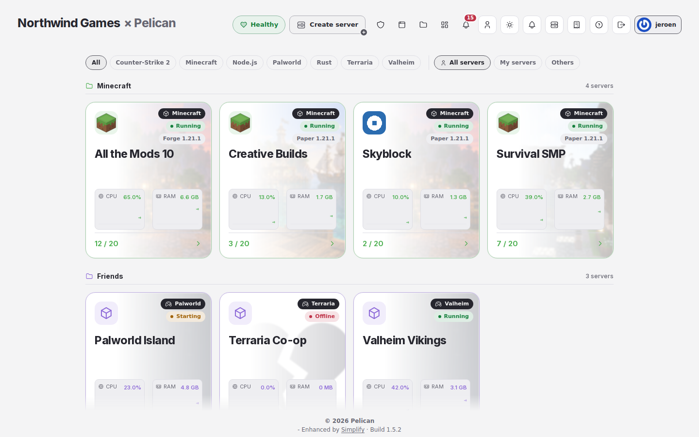

# Simplify Hosting

A plugin for the [Pelican panel](https://pelican.dev) for hosting companies. It links your panel to your billing
system: customers find the page to upgrade a server, their client area and your order page, and admins of a large
panel start in Simplify's host mode.

It works on its own. With [Simplify](https://github.com/jerajerajerajera/Simplify) installed, the links also show
inside Simplify and it shows up in Simplify's add-on list.

## Setup

1. Install the plugin from the Pelican Hub.
2. Open **Admin → Simplify → Hosting**.
3. Pick your billing system (WHMCS, Paymenter or Blesta) and enter its address: the links are filled in for you.
   Change them or fill them in yourself, and press **Save**.

## What it adds

| Setting | Without Simplify | With Simplify |
| --- | --- | --- |
| **Billing link** | "Upgrade this server" on a server's console | "Upgrade this server" in the ⋯ menu of the server page; on a suspended server "Pay invoice", also on the server's card (Simplify 1.5.5 and newer) |
| **Client area link** | "Client area" in everyone's account menu | also an icon in Simplify's account menu, and beside a greeting above a customer's servers |
| **Order link** | | "Order a server" beside that greeting |
| **Open in host mode** | | admins of a panel with more than one node start in host mode, until they pick a mode |

The billing link may hold `{uuid}` and `{external_id}`, which become the server's own values, for example
`https://billing.example.com/clientarea.php?action=productdetails&id={external_id}`.

Customers are users who are not admins. Every link must start with `https://`. The plugin never bills anyone
itself and sends nothing anywhere: it only shows your links.

<picture>
  <source media="(prefers-color-scheme: dark)" srcset="docs/screenshots/admin-overview-account-desktop-dark.png">
  
</picture>

## Coming from Simplify 1.0

Simplify 1.0 had "A hosting company" and the billing link in its own settings. When you install Hosting, it takes
both over once, so nothing has to be entered again.

Updates come from the Pelican Hub only.

## Development

- `bash tests/run.sh` runs the checks that need no panel, including `tests/hub-check.py`.
- `pint` formats the code (Laravel preset).
- `python3 scripts/build-package.py` builds the zip for the Hub.

## License

Source available, see [LICENSE.md](LICENSE.md). Copyright (c) 2026 Jeroen (jerajerajerajera).
