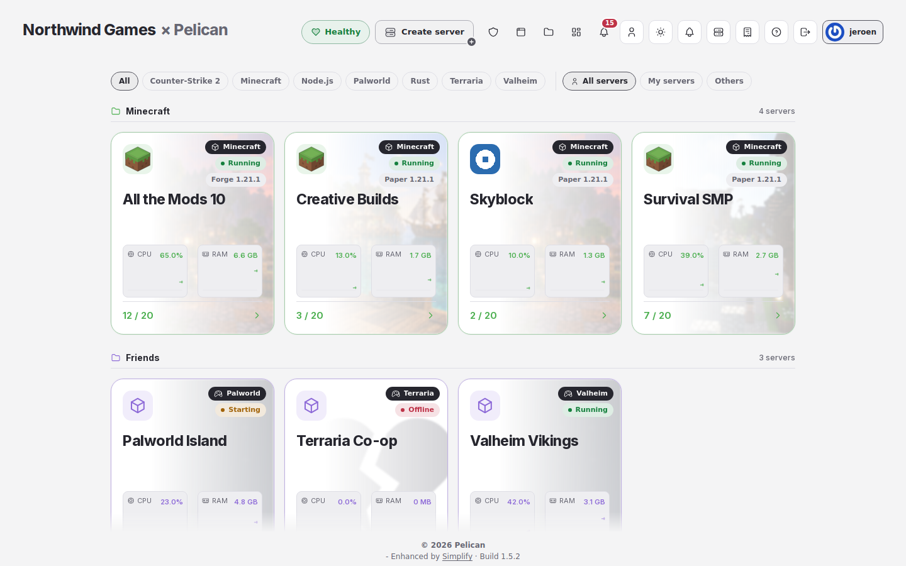
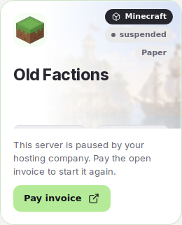

# Simplify Hosting

A plugin for the [Pelican panel](https://pelican.dev) for hosting companies. It links your panel to your billing
system: customers find the page to upgrade a server, their client area and your order page, they ask you questions in
tickets, and admins of a large panel start on Simplify's Admin page.

It works on its own. With [Simplify](https://github.com/jerajerajerajera/Simplify) installed, the links also show
inside Simplify and it shows up in Simplify's add-on list.

## Setup

1. Install the plugin from the Pelican Hub.
2. Open **Simplify settings › Add-ons › Hosting**. Without Simplify, open **Hosting** under **Simplify** in Pelican's
   admin menu.
3. Pick your billing system (WHMCS, Paymenter or Blesta) and enter its address: the links are filled in for you.
   Change them or fill them in yourself, and press **Save**.

## What it adds

| Setting | Without Simplify | With Simplify |
| --- | --- | --- |
| **Billing link** | "Upgrade this server" on a server's console | "Upgrade this server" in the ⋯ menu of the server page; on a suspended server "Pay invoice", also on the server's card |
| **Client area link** | "Client area" in everyone's account menu | also an icon in Simplify's account menu, and beside a greeting above a customer's servers |
| **Order link** | | "Order a server" beside that greeting |
| **Start admins on the Admin page** | | admins of a panel with more than one node start on Simplify's Admin page (Health), once per session |

The billing link may hold `{uuid}` and `{external_id}`, which become the server's own values, for example
`https://billing.example.com/clientarea.php?action=productdetails&id={external_id}`. A server without an external id,
such as one made in the panel itself, gets no link that needs it.

Customers are users who are not admins. Every link must start with `https://`. The plugin never bills anyone
itself and sends nothing anywhere: it only shows your links.

<picture>
  <source media="(prefers-color-scheme: dark)" srcset="docs/screenshots/admin-overview-account-desktop-dark.png">
  
</picture>
<picture>
  <source media="(prefers-color-scheme: dark)" srcset="docs/screenshots/suspended-card-desktop-dark.png">
  
</picture>

## Tickets

Turn on **Let customers open tickets** in the settings. Customers then get **Support** in each server's menu and
**My tickets** in their account menu. A ticket has a subject, a priority (Low, Normal or High), one of your own
categories, and optionally the server's last 100 console lines. Tickets without a server (billing, general questions)
are allowed unless you turn that off.

Support works in **Tickets** under **Simplify** in Admin: filter by Open, Waiting for customer, Closed or Assigned to
me, answer the customer or write an internal note the customer never sees, and set the status, priority and who
handles it. Root admins handle tickets, and so does every role with **Ticket › Handle** under People › Roles.

New tickets and replies reach support in the bell, and as an app notification on phones where Simplify's push is on.
The customer hears of every answer the same way. With **Close tickets after 7 days** on, a ticket that waits a week for
the customer closes; a reply opens it again.

Another add-on can start a ticket with a text filled in, for example Explain with an explained error:
`Simplify\Hosting\Services\Tickets::draft(?Server $server, string $subject, string $text): ?string` returns the
address of the new ticket (null while tickets are off) and keeps the text in the session, never in the address.

## Coming from Simplify 1.0

Simplify 1.0 had "A hosting company" and the billing link in its own settings. When you install Hosting, it takes
both over once, so nothing has to be entered again.

Updates come from the Pelican Hub only.

## Development

- `bash tests/run.sh` runs the checks that need no panel, including `tests/hub-check.py`.
- `pint` formats the code (Laravel preset).
- `python3 scripts/build-package.py` builds the zip for the Hub.

## License

Source available, see [LICENSE.md](LICENSE.md). Copyright (c) 2026 Jeroen (jerajerajerajera).
